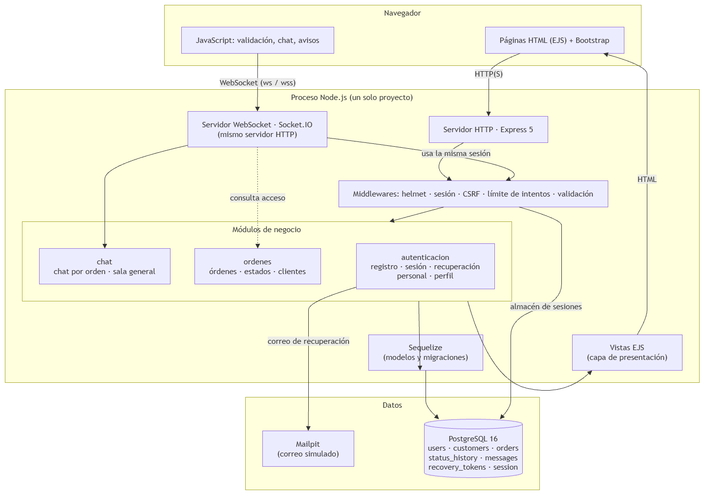
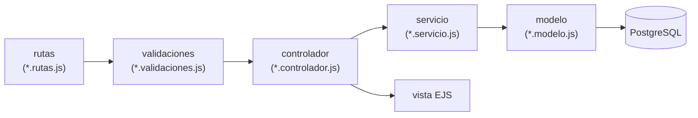
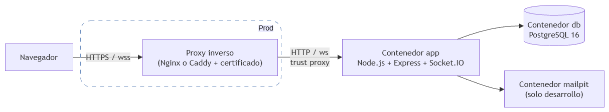

# Arquitectura del monolito

Reparus Tec es **un solo proyecto desplegable**: las vistas se renderizan en el servidor, el enrutamiento se resuelve en el servidor, la lógica de negocio y la persistencia están en el mismo código, y el servidor WebSocket forma parte del mismo proceso.

## Diagrama general

## Capas dentro de cada módulo

Cada módulo (`autenticacion`, `ordenes`, `chat`) sigue el mismo recorrido:

| Capa | Responsabilidad |
| --- | --- |
| **Rutas** | Asocian una URL con sus middlewares (sesión, rol, validación) y su controlador. |
| **Validaciones** | Reglas de `express-validator`: el servidor nunca confía en lo que valida el navegador. |
| **Controlador** | Lee la petición, llama al servicio y elige la vista o la redirección. No contiene reglas de negocio. |
| **Servicio** | Reglas de negocio (transiciones de estado, acceso a una orden, hash de claves…). |
| **Modelo** | Tablas de Sequelize. |
| **Vista** | Plantillas EJS renderizadas en el servidor. |

**Regla de módulos:** un módulo no importa los modelos de otro. Se comunican con identificadores y funciones de servicio; por ejemplo el chat pregunta a `ordenes` con `canUserAccessOrder` si un usuario puede ver una orden.

## Servidor WebSocket

Socket.IO se crea sobre **el mismo servidor HTTP** de Express (`configuracion/tiempoReal.js`) y reutiliza el middleware de sesión: el navegador envía la misma cookie al conectar, así que el servidor sabe quién es el usuario sin pedirle credenciales otra vez. Sin sesión iniciada, la conexión se rechaza. Detalle de salas y eventos en [chat-websocket.md](chat-websocket.md).

## Despliegue en prod(objetivo)

Con Docker Compose se levantan `app`, `db` y `mailpit`. En esta entrega del primer bimestre la aplicación se ejecuta en local por HTTP.

En el despliegue `production` la aplicación va detrás de HTTPS para que el chat use `wss://` y la cookie de sesión, marcada `secure` en producción, viaje cifrada. 
