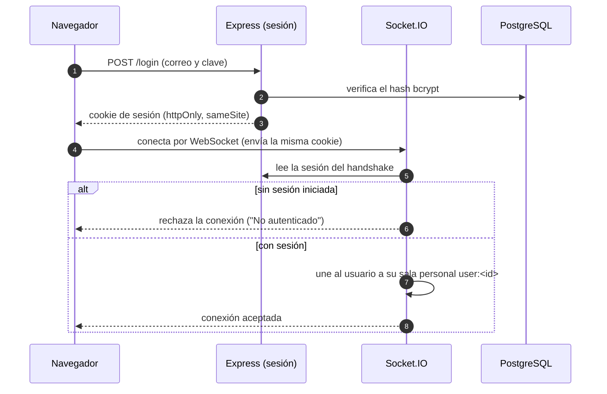
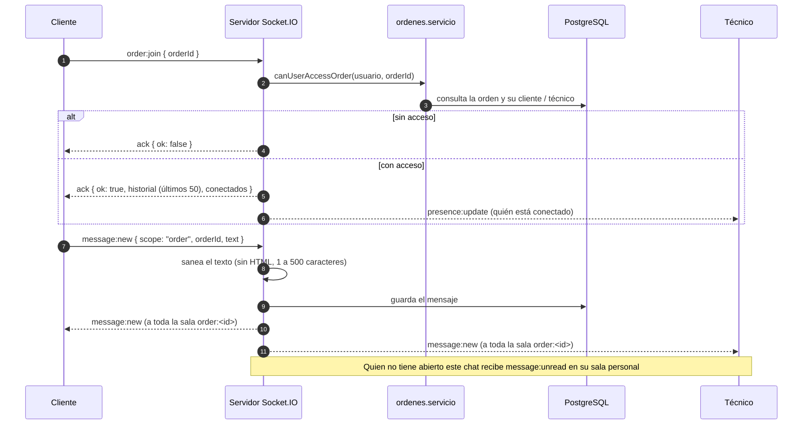

# Chat y tiempo real

## Conexión autenticada

## Salas

| Sala | Nombre | Quién entra | Para qué |
| --- | --- | --- | --- |
| Personal | `user:<id>` | El propio usuario, automáticamente | Recibir sus avisos (cambio de estado, mensaje nuevo) |
| Orden | `order:<id>` | Cliente dueño, técnico asignado y administradores | Conversación de esa reparación |
| General | `staff:general` | Solo administradores y técnicos | Coordinación interna del taller |

**El navegador nunca elige una sala:** pide unirse y el servidor decide consultando la base de datos según el rol y la orden. Los clientes no entran a la sala general: ya tienen su sala por orden con los técnicos de sus equipos.

## Unirse y enviar un mensaje

## Eventos

Nombres en inglés con el formato `entidad:acción`. Los que envía el navegador llevan `ack` (`{ ok: true }` o `{ ok: false, error }`).

| Evento | Dirección | Datos | Descripción |
| --- | --- | --- | --- |
| `order:join` / `order:leave` | navegador → servidor | `{ orderId }` | Entrar o salir del chat de una orden |
| `general:join` / `general:leave` | navegador → servidor | `{}` | Entrar o salir de la sala general (solo personal) |
| `message:new` | ambos | `{ scope, orderId?, text }` | El navegador lo envía; el servidor lo guarda y lo reenvía a la sala |
| `presence:update` | servidor → navegador | `{ scope, orderId?, users }` | Quién está conectado en la sala |
| `order:status-changed` | servidor → navegador | `{ orderId, orderNumber, previousStatus, newStatus, newStatusLabel, at }` | **Aviso 1:** cambió el estado de una orden (cliente dueño, técnico asignado y administradores) |
| `message:unread` | servidor → navegador | `{ orderId, orderNumber, from, at }` | **Aviso 2:** llegó un mensaje a una orden cuyo chat no tienes abierto |

## Persistencia

Los mensajes se guardan en la tabla `messages` **antes** de reenviarse (`order_id` nulo significa sala general). Al unirse a una sala se carga el historial (últimos 50 mensajes). El saneamiento elimina etiquetas HTML y scripts, y se rechazan los mensajes vacíos o de más de 500 caracteres.
