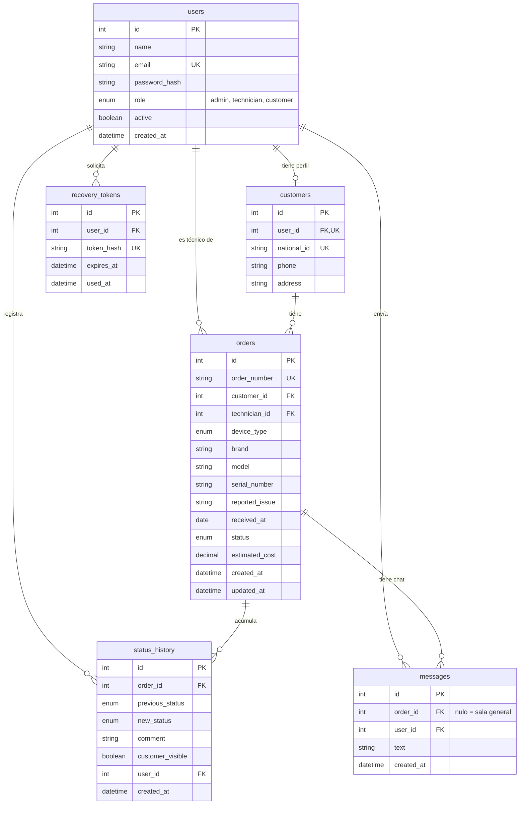

# Modelo entidad-relación

Seis tablas en PostgreSQL. Los nombres de tablas y columnas están en inglés y en snake_case.
Este diagrama debe mantenerse igual que las migraciones de `base-de-datos/migraciones/`.

## Valores de los enum

| Columna                                                                        | Valores                                                                  |
| ------------------------------------------------------------------------------ | ------------------------------------------------------------------------ |
| `users.role`                                                                   | `admin`, `technician`, `customer`                                        |
| `orders.device_type`                                                           | `laptop`, `desktop`, `all_in_one`, `other`                               |
| `orders.status`, `status_history.previous_status`, `status_history.new_status` | `received`, `diagnosing`, `repairing`, `ready`, `delivered`, `cancelled` |

## Índices

| Tabla             | Índice                          | Para qué               |
| ----------------- | ------------------------------- | ---------------------- |
| `users`           | `email` (único)                 | Inicio de sesión       |
| `customers`       | `national_id` (único)           | Búsqueda de cliente    |
| `orders`          | `order_number` (único)          | Búsqueda por número    |
| `orders`          | `status`                        | Filtro del listado     |
| `orders`          | `customer_id`, `technician_id`  | Listado por rol        |
| `status_history`  | `order_id`, `created_at`        | Historial de una orden |
| `messages`        | `order_id`, `created_at`        | Historial del chat     |
| `recovery_tokens` | `token_hash` (único), `user_id` | Validar el token       |

## Restricciones

- `orders.estimated_cost` debe ser mayor o igual a 0.
- Eliminar una orden elimina su historial y sus mensajes (`ON DELETE CASCADE`).
- No se puede eliminar un cliente que tiene órdenes (`ON DELETE RESTRICT`).
