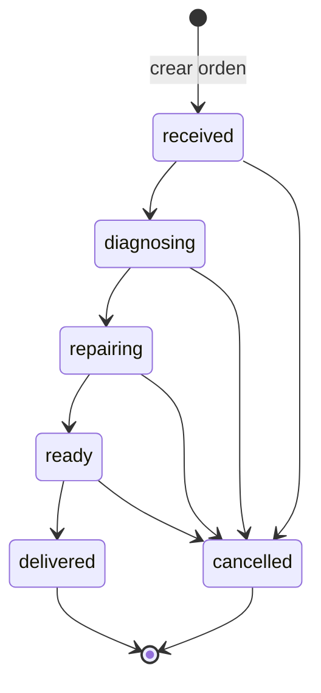

# Historias de usuario

Se detallan las 16 historias de usuarios que se implementaron con su respectiva prueba automatizada que las cubre. Prioridad: **Alta**, **Media** o **Baja**.

## Resumen

| ID | Historia | Rol | Prioridad | Pantalla o evento | Pruebas |
| --- | --- | --- | --- | --- | --- |
| HU-01 | Registro de cliente | Cliente | Alta | `/registro` | `pruebas/autenticacion/registro.test.js` |
| HU-02 | Inicio de sesión | Todos | Alta | `/login` | `pruebas/autenticacion/login.test.js` |
| HU-03 | Recuperación de clave | Todos | Alta | `/recuperar`, `/restablecer` | `pruebas/autenticacion/recuperacion.test.js` |
| HU-04 | Cerrar sesión y rutas protegidas | Todos | Alta | `POST /logout` | `pruebas/autenticacion/sesion.test.js` |
| HU-05 | Crear usuarios del personal | Administrador | Alta | `/admin/usuarios` | `pruebas/autenticacion/sesion.test.js` |
| HU-06 | Consultar y editar clientes | Administrador | Media | `/clientes` | `pruebas/ordenes/clientes.test.js` |
| HU-07 | Crear orden de reparación | Administrador | Alta | `/ordenes/nueva` | `pruebas/ordenes/crear.test.js` |
| HU-08 | Listar y filtrar órdenes | Todos | Alta | `/ordenes` | `pruebas/ordenes/listado-detalle.test.js` |
| HU-09 | Detalle de orden | Todos | Alta | `/ordenes/:id` | `pruebas/ordenes/listado-detalle.test.js` |
| HU-10 | Editar, asignar técnico y eliminar orden | Administrador | Alta | `/ordenes/:id/editar`, `DELETE /ordenes/:id` | `pruebas/ordenes/editar-eliminar.test.js` |
| HU-11 | Cambiar estado de una orden | Técnico y administrador | Alta | `POST /ordenes/:id/estado` | `pruebas/ordenes/cambiar-estado.test.js` |
| HU-12 | Aviso en tiempo real del cambio de estado | Cliente, técnico y administrador | Alta | evento `order:status-changed` | `pruebas/chat/aviso-estado.test.js` |
| HU-13 | Chat por orden | Cliente, técnico y administrador | Alta | detalle de la orden, `order:join`, `message:new` | `pruebas/chat/chat-orden.test.js` |
| HU-14 | Sala general del taller | Técnico y administrador | Alta | `/chat/general` | `pruebas/chat/sala-general.test.js` |
| HU-15 | Aviso de mensaje nuevo | Cliente, técnico y administrador | Media | evento `message:unread` | `pruebas/chat/aviso-mensaje.test.js` |
| HU-16 | Perfil del cliente | Cliente | Baja | `/perfil` | `pruebas/autenticacion/perfil.test.js` |

Transversales: **T-01** base del proyecto (`pruebas/base.test.js`, `pruebas/chat/socket-base.test.js`), **T-02** pruebas y rendimiento ([pruebas.md](pruebas.md), [rendimiento](rendimiento/README.md)) y **T-03** diagramas.

## Detalle de lo implementado

Cada ticket que se detalla a conitnuación se encuentran en [clickup]()

### Autenticación

- **HU-01.** Como cliente quiero registrarme para consultar el estado de mis equipos. El registro pide nombre, correo, cédula (10 dígitos, única), teléfono (10 dígitos), dirección opcional y la clave dos veces. El rol siempre es cliente aunque el formulario envíe otro, y el usuario y su perfil se crean en una sola transacción.
- **HU-02.** Como usuario quiero iniciar sesión. La clave se compara contra el hash bcrypt de la base de datos. Un correo inexistente, una clave incorrecta o un usuario inactivo dan el mismo mensaje, y hay un límite de intentos por IP.
- **HU-03.** Como usuario quiero recuperar mi clave. El enlace llega por correo (en desarrollo, a Mailpit), vale 30 minutos y se usa una sola vez; pedir un enlace nuevo invalida el anterior. La clave nueva cumple las reglas del registro y se confirma escribiéndola dos veces.
- **HU-04.** Como usuario quiero cerrar sesión y que las pantallas privadas estén protegidas. Sin sesión se redirige a `/login`; cerrar sesión destruye la sesión del servidor y borra la cookie.
- **HU-05.** Como administrador quiero crear técnicos y administradores. Desde esa pantalla no se pueden crear clientes ni roles inventados.

### Órdenes

- **HU-07.** El administrador crea una orden buscando al cliente por cédula. Valida tipo de equipo (laptop, escritorio, todo en uno u otro), marca, modelo, problema reportado, fecha no futura y costo estimado no negativo. Genera el número de orden y registra el primer estado.
- **HU-08.** Listado paginado de **10 por página** con búsqueda (número de orden, cédula o nombre del cliente) y filtro por estado. Cada rol ve solo lo suyo: el cliente, sus órdenes; el técnico, las asignadas; el administrador, todas.
- **HU-09.** Detalle con equipo, cliente, técnico e historial de estados. El cliente no ve las notas internas ni datos de otras personas; una orden ajena responde 404, igual que una que no existe.
- **HU-10.** El administrador edita los datos (salvo órdenes entregadas o canceladas), asigna técnico y elimina con una ventana de confirmación. Eliminar borra también el historial y los mensajes.
- **HU-11.** Técnico o administrador cambian el estado con un comentario y deciden si es **visible para el cliente** o una nota interna. El servidor rechaza cualquier transición fuera del flujo (respuesta 409). Pasar a *En diagnóstico* exige técnico asignado, a *En reparación* un costo estimado, y *Listo* y *Cancelado* un comentario.

Estados: `received` (Recibida), `diagnosing` (En diagnóstico), `repairing` (En reparación), `ready` (Lista), `delivered` (Entregada), `cancelled` (Cancelada).

- **HU-06.** El administrador lista clientes con búsqueda por cédula o nombre (10 por página) y edita **solo teléfono y dirección**; la cédula, el nombre y el correo no se pueden cambiar. No se crean clientes aquí: se registran con HU-01.
- **HU-16.** El cliente edita su propio nombre, teléfono y dirección; el correo y la cédula no se cambian.

### Chat y tiempo real

- **HU-13.** Chat por orden entre el cliente, el técnico asignado y los administradores. Historial persistido (últimos 50), usuarios conectados y mensajes saneados.
- **HU-14.** Sala general **solo para el personal**; los clientes reciben 403.
- **HU-12.** Al cambiar el estado, el cliente dueño, el técnico asignado y los administradores ven un aviso en pantalla sin recargar y la insignia de estado se actualiza.
- **HU-15.** Cuando llega un mensaje a una orden cuyo chat no tienes abierto, aparece un aviso, un contador junto a «Órdenes» y la etiqueta «Mensaje nuevo» en el listado. Desaparece al abrir el chat. La marca se guarda en el navegador; solo se avisa de mensajes que llegan con la sesión conectada.
